# 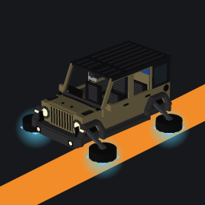 Yasuflatland Ride

[](https://github.com/yasuflatland-lf/yasuflatland-ride-minecraft/actions/workflows/unit-test.yml)
[](https://github.com/yasuflatland-lf/yasuflatland-ride-minecraft/actions/workflows/integration-test.yml)
[](https://codecov.io/gh/yasuflatland-lf/yasuflatland-ride-minecraft)
[](https://app.codecov.io/gh/yasuflatland-lf/yasuflatland-ride-minecraft/components)
[](LICENSE)

| SUV on the ground | Headlights on | Flying | Under water |
|:---:|:---:|:---:|:---:|
| 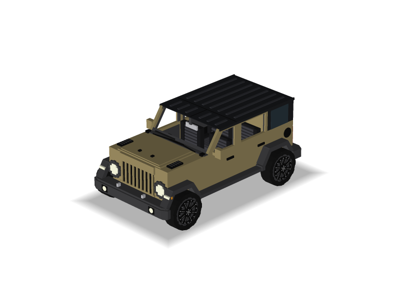 | 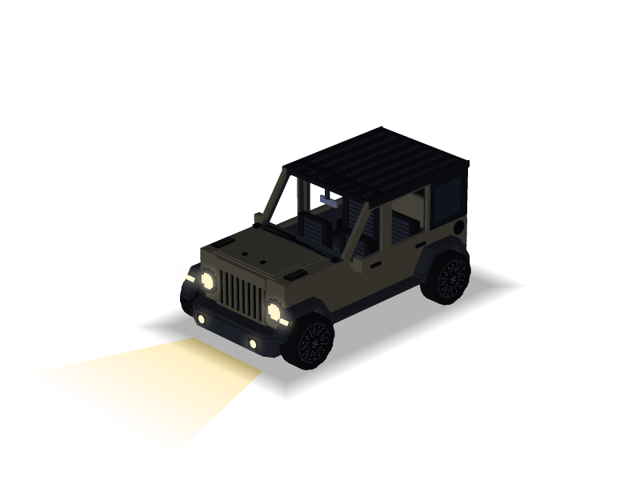 | 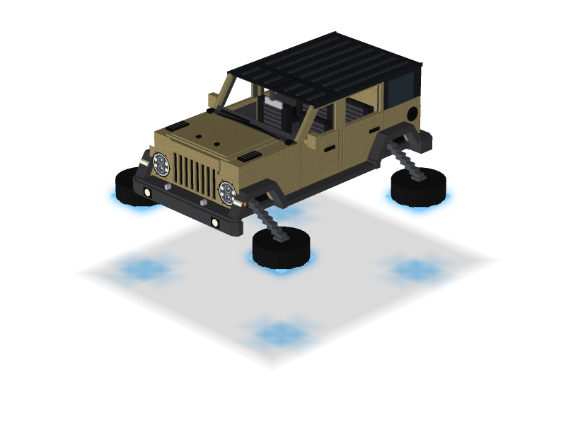 | 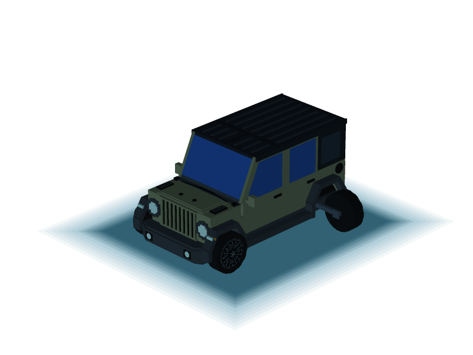 |
| **Sports boat on the water** | **Headlights on** | **From the rear** | **From above** |
| 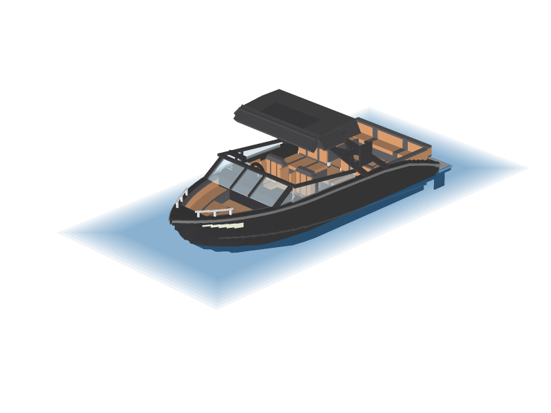 | 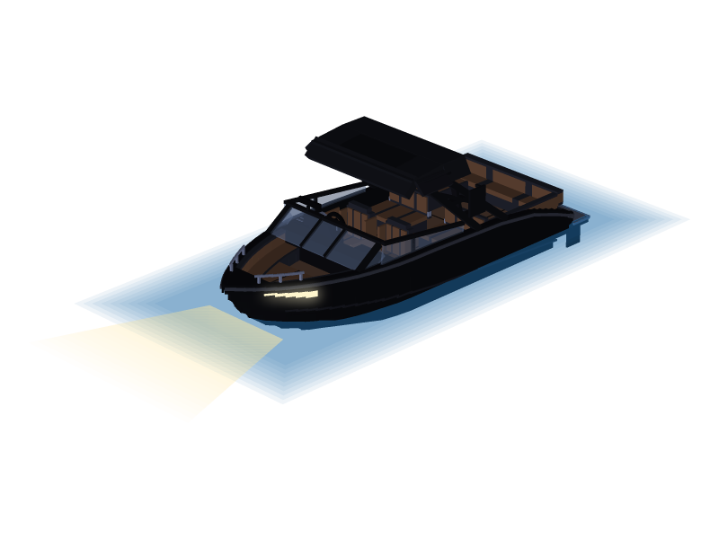 | 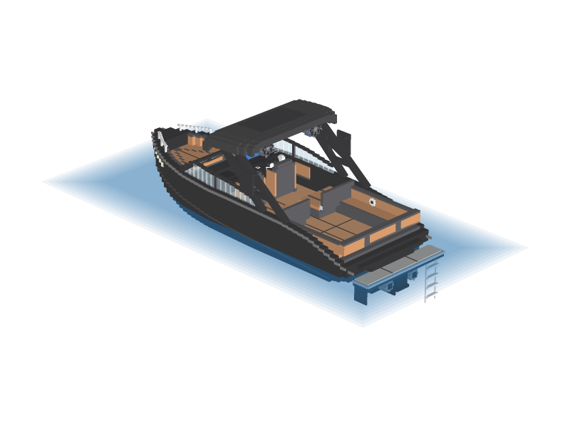 | 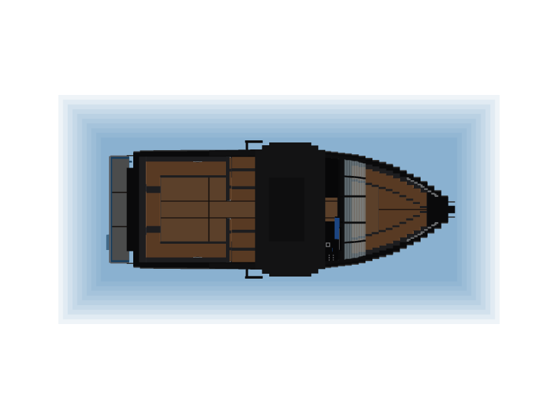 |
| **Camper** | **Headlights on** | **From the side** | **From the rear** |
| 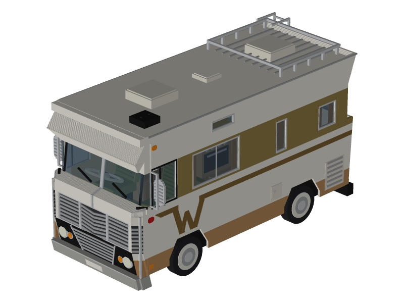 | 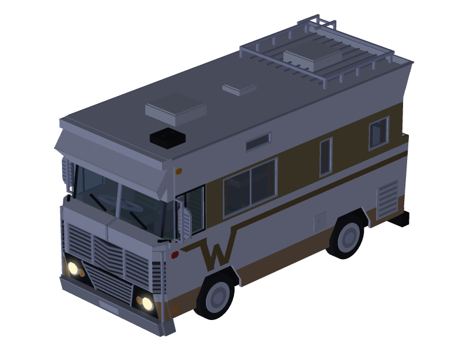 | 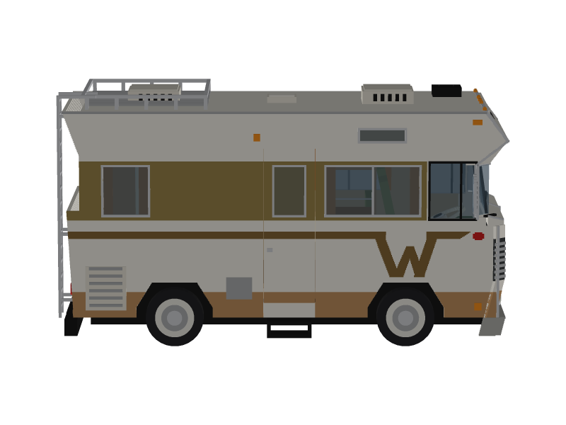 | 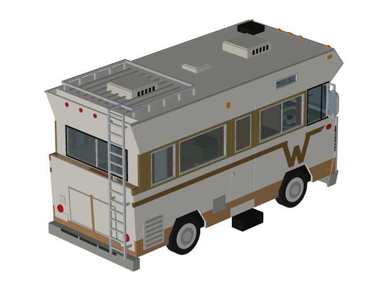 |
| **Bulldozer** | **Headlights on** | **From the side** | **From the rear** |
| 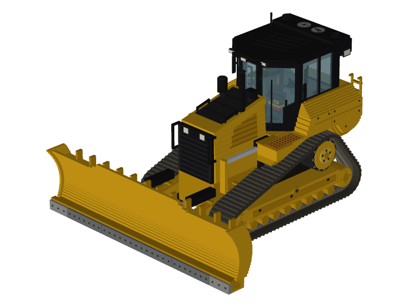 | 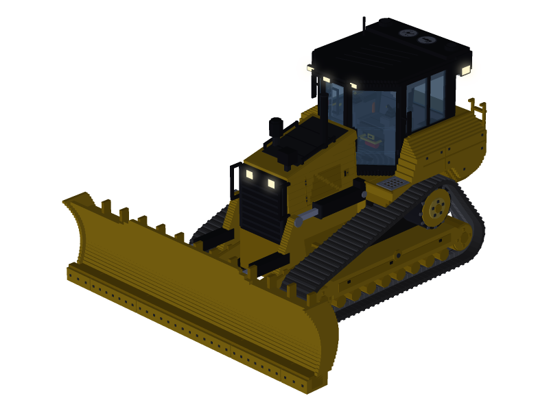 | 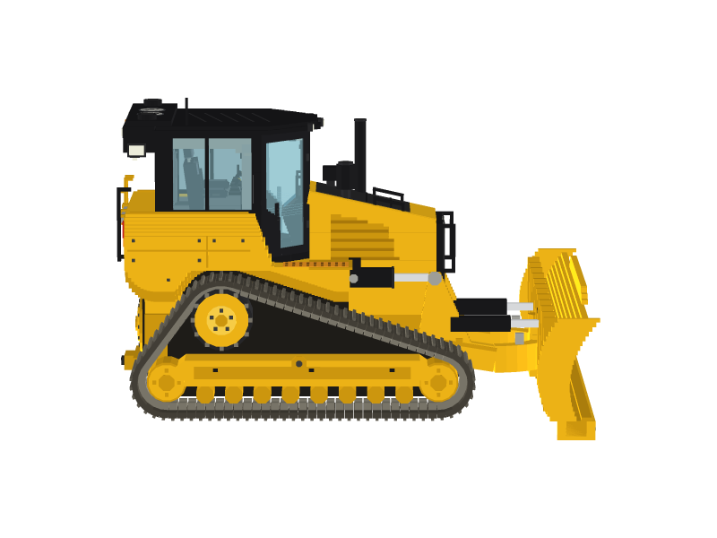 | 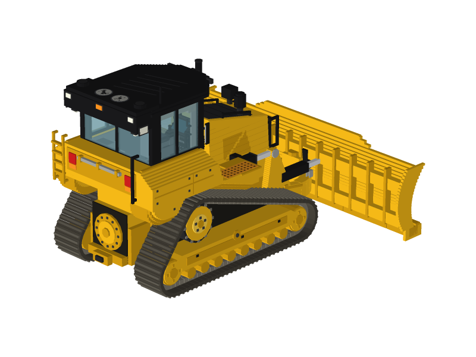 |

A vehicle add-on for Minecraft Bedrock Edition 1.21.120 or newer. It is built as a Behavior Pack + Resource Pack driven by the stable Script API (`@minecraft/server` 2.x), with no experimental toggles required. The target setup is a Bedrock Dedicated Server on a home LAN or a Realm, with players joining from PC (keyboard) and mobile (touch).

This add-on holds rides, and for now the build tools, which will move to their own add-on ([ADR 0178](docs/adr/0178-bulldozer-build-tools-in-a-separate-namespace.md)). House-building parts will ship as a separate add-on with their own namespace. The `yasu_ride` namespace never changes once Yasuflatland Ride is first released ([ADR 0047](docs/adr/0047-rename-to-yasuflatland-ride.md)).

## Vehicles

| Vehicle | What it does | Details |
|---|---|---|
| **SUV** | Drives on land, flies, and dives as a submarine. Every player gets one on their first join | [Controls and details](docs/vehicles/suv.md) |
| **Sports boat** | Drives on water and lava, including Nether lava seas; seated riders are protected from fire. Shores stop it, and on land it can only reverse | [Controls and details](docs/vehicles/sportsboat.md) |
| **Camper** | Drives, flies, and dives like the SUV, with a long body and a facing dinette | [Controls and details](docs/vehicles/camper.md) |
| **Bulldozer** | Pivots, hops, flies, and dives; with its blade lowered it clears hills and flight tunnels, and raised it climbs steps; Wide Blade doubles the cut and ram width, Road Paver lays the block in the selected slot behind it, and its cab monitor shows UP/DOWN, NORM/WIDE, or OFF/ON for the held switch, and the build tools select, fill, copy, and paste blocks on foot or while riding. Every player gets one on their first join | [Controls and details](docs/vehicles/bulldozer.md) |

The SUV, sports boat, and camper each seat 4; the bulldozer seats 1. All four can be repainted with any of the 16 dyes, and light the way with a headlight switch item. Each can be placed from its item and broken back into it. Each player keeps at most 10 SUVs, 1 sports boat, 1 camper, and 1 bulldozer: placing one more removes that player's oldest of that kind.

## Items

Items other than vehicles, such as the 19 pieces of camping gear made to decorate a parked camper, the Building Tools group (Build Tool, Selection Wand, Blade Up/Down, Wide Blade, and Road Paver), are listed in [the item groups](docs/items/README.md).

## Installing

Download `yasuflatland-ride-<version>.mcaddon` from the [latest release](https://github.com/yasuflatland-lf/yasuflatland-ride-minecraft/releases/latest) and open it on your device; on iPad, follow [these steps](docs/installing-on-ipad.md). Turn on **Yasuflatland Ride** under a world's Behavior Packs; no experiments are needed. Players who join a server that already has the packs do not need to install anything: the server sends the Resource Pack when they join, so accept the download prompt. To play on a Realm, upload a world that has the packs turned on, as described in [Installing on a Realm](docs/installing-on-a-realm.md).

Upgrading from MyCar 0.5.0 or earlier? Read [the upgrade notes](docs/upgrading.md) first.

## Design

Design decisions are recorded as ADRs in [`docs/adr`](docs/adr/README.md). Highlights:

- Movement is script-driven: the script sets the vehicle's velocity every tick ([0002](docs/adr/0002-script-driven-vehicle-movement.md))
- Touch joystick input is scaled so pushing it halfway forward gives full throttle, matching keyboard players, and a stick held sideways turns the vehicle slowly forward instead of reversing ([0018](docs/adr/0018-sideways-stick-creeps-forward.md))
- Code is split into domain, application, and infrastructure layers so the driving logic does not depend on `@minecraft/server` ([0012](docs/adr/0012-ddd-layered-architecture.md))

## Development

Node and pnpm versions are pinned in `mise.toml`. Install [mise](https://mise.jdx.dev/), then run:

```sh
mise install
pnpm install
pnpm lint            # format and lint check with Biome
pnpm test            # unit tests, property-based tests, and the layer dependency check
pnpm build           # bundle the TypeScript into the Behavior Pack
pnpm package         # zip the packs into dist/yasuflatland-ride-<version>.mcaddon (run after build)
pnpm model           # generate the vehicle models and textures, the camping gear block models and atlas, the README and item previews, and pack icons
pnpm model:check     # fail if the camping gear models, the README or item previews, or the pack icons are out of date
pnpm server:up       # start the dev BDS in Docker
pnpm server:restart  # restart it under a new dev-only Resource Pack version
pnpm test:game       # run impacted in-game scenarios in 4 lanes locally by default
```

Local in-game runs select only impacted scenarios. `GAME_TEST_ALL=1` runs everything, and `GAME_TEST_LANES=1` runs serially. `GAME_TEST_FEATURES=<tags>` selects comma-separated feature tags, and `GAME_TEST_BASE=<ref>` overrides the merge base used for impact selection. `GAME_TEST_AT=<0..7>` runs inside one lane for converting scenarios and defaults to serial execution.

CI runs the Biome check, the README preview and pack icon check, type checking, tests, the build, and packaging on every pull request. In-game CI runs every scenario in 4 serial shards plus one 4-lane job.

The dev world starts fresh as `yasuflatland-ride-dev`. The world from before the rename can be deleted by hand; its path is recorded in [ADR 0047](docs/adr/0047-rename-to-yasuflatland-ride.md). Before your first `pnpm server:up` after the rename, remove the dev container from before the rename once, since it still holds the server ports: find its name with `docker ps -a`, then run `docker rm -f <name>`.

After the stack merges, the owner will rename the GitHub repository to `yasuflatland-ride-minecraft` and check the Codecov badge. The links above use that destination.

The manual test checklist is in [`docs/manual-test.md`](docs/manual-test.md), and releasing is described in [`docs/releasing.md`](docs/releasing.md).

## License

[MIT](LICENSE)
