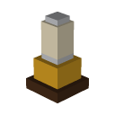

# Camping gear

Small 1970s motorhome gear made to decorate a parked camper. Back to the [item groups](README.md).

Each item stands in the middle of one slot on the camper's furniture, except the Macrame Hanging Planter, which hangs from the ceiling hook. A standing item goes on any spot except the ceiling hook: the dashboard, the table, the dinette seats, the shelf, the stove, the counter, or the wall cabinet. The ceiling hook takes only the hanging planter (ADR 0097). Sizes are width × height in pixels, at 16 pixels per block. `pnpm model` draws the previews from the block models it generates from `tools/camping_gear.json`.

| Preview | Name | Size (px) | Stands or hangs | Reference |
|---|---|---|---|---|
|  | Potted Plant | 5 × 8 | Stands | None |
|  | Macrame Hanging Planter | 5 × 10 | Hangs from the ceiling hook | None |
|  | Cactus Pot | 4 × 7 | Stands | None |
|  | Percolator | 4 × 7 | Stands | None |
|  | Enamel Kettle | 5 × 5 | Stands | None |
|  | Saucepan | 6 × 3 | Stands | None |
|  | Pair of Mugs | 4 × 3 | Stands | None |
|  | Glass Sugar Pot | 3 × 4 | Stands | None |
|  | Fruit Bowl | 6 × 3 | Stands | None |
|  | Chrome Toaster | 6 × 5 | Stands | None |
|  | Oil Lamp | 4 × 7 | Stands | None |
|  | Lava Lamp | 3 × 8 | Stands | None |
|  | Transistor Radio | 6 × 4 | Stands | None |
|  | Stack of Books | 6 × 3 | Stands | None |
|  | Folded Road Map | 6 × 1 | Stands | None |
|  | Photo Frame | 4 × 5 | Stands | None |
|  | Cushion | 7 × 3 | Stands | None |
|  | Tissue Box | 5 × 3 | Stands | None |
|  | Desk Fan | 4 × 6 | Stands | None |

## In the game

Creative players find every item above in the **Camping Gear** group at the end of the Items tab. Each item has a decor block, `yasu_ride:<id>_decor`, that the parked camper lays on a furniture slot. The block has no collision and cannot be broken. Its `yasu_ride:height` state (0 to 15) lifts the gear by that many pixels to the slot's top. Its `yasu_ride:face` state is the parked camper's facing in quarter turns (0 south, 1 west, 2 north, 3 east). The block turns the gear so that the side shown at the front of its preview faces the camper's front.

## Getting the gear

The first time you place a camper, you get one Camping Gear Box. Use it (tap or right-click, in the air or on a block) to unpack all 19 items into your inventory, each marked "Camping gear" under its name; what does not fit drops at your feet. Each player gets one box, however many campers they place. In Creative, the Camping Gear group at the end of the Items tab holds the box and every item.
