# Camping gear

Small 1970s motorhome gear made to decorate a parked camper. Back to the [item groups](README.md).

Each item stands in the middle of one slot on the camper's furniture, or at one end of the table or of a compartment behind a door, which hold two items each, except the Macrame Hanging Planter, which hangs from the ceiling hook. On the stove, the slot is the one burner in the middle of its top. A standing item goes on any spot except the ceiling hook: the dashboard, the table, the dinette seats, the stove, the counter, or inside the wall cabinet or the fridge, two behind each door while that door is open (ADR 0114, 0123). The ceiling hook takes only the hanging planter (ADR 0097). Sizes are width × height in pixels, at 16 pixels per block. `pnpm model` draws the previews from the block models it generates from `tools/camping_gear.json`.

| Preview | Name | Size (px) | Stands or hangs | Reference |
|---|---|---|---|---|
|  | Potted Plant | 5 × 8 | Stands | None |
| 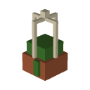 | Macrame Hanging Planter | 5 × 10 | Hangs from the ceiling hook | None |
|  | Cactus Pot | 4 × 7 | Stands | None |
| 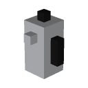 | Percolator | 4 × 7 | Stands | None |
| 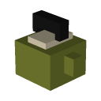 | Enamel Kettle | 5 × 5 | Stands | None |
| 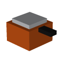 | Saucepan | 6 × 3 | Stands | None |
| 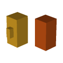 | Pair of Mugs | 4 × 3 | Stands | None |
|  | Glass Sugar Pot | 3 × 4 | Stands | None |
|  | Fruit Bowl | 6 × 3 | Stands | None |
| 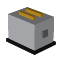 | Chrome Toaster | 6 × 5 | Stands | None |
| 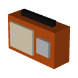 | Transistor Radio | 6 × 4 | Stands | None |
| 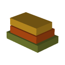 | Stack of Books | 6 × 3 | Stands | None |
| 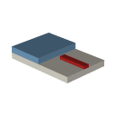 | Folded Road Map | 6 × 1 | Stands | None |
| 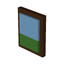 | Photo Frame | 4 × 5 | Stands | None |
| 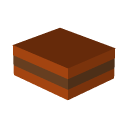 | Cushion | 7 × 3 | Stands | None |
| 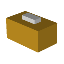 | Tissue Box | 5 × 3 | Stands | None |
| 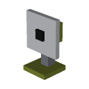 | Desk Fan | 4 × 6 | Stands | None |

A camper saved with a Lantern or an Oil Lamp loads without it (ADR 0173).

## Low Chair (outside the vehicles)

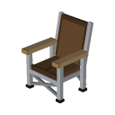

A low folding camp chair with a brown canvas sling seat and a reclined canvas back on a silver aluminium frame, with wooden armrests and X braces under the seat and across the back. It is not decor: it stands on the ground outside the vehicles (ADR 0122). It is about 12 × 16 pixels, and its seat is 6 pixels above the ground.

- **Place it:** use the Low Chair item on the top of a block outside the vehicles. The chair faces you, turned to the nearest eighth of a turn. Clicked on short grass, a flower, or a carpet, it settles onto the ground under it. It needs two free blocks above the block, and it does not go on a camper's room blocks, within a vehicle's reach, or where another chair already stands. Outside Creative it uses up the item.
- **Sit on it:** long-press it on touch screens, or right-click it with a mouse; the button reads **Sit**. Sneak or jump to get up.
- **Take it back:** hit it three times in quick succession while nobody sits on it. It folds up and drops its item. Each hit before the third tells you how many more it takes.
- **Get one:** in Creative, it is the first item in the Camping Gear (Outside) group near the end of the Items tab. In Survival, craft it from two leather, two sticks, and two iron ingots (leather top-left and middle, sticks on either side of the middle, iron ingots in the bottom corners).

## Noga Chair (outside the vehicles)

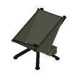

A compact folding chair with a plain gray-olive sling, a high wrap-around back with bound edges, and a black aluminium frame. Like the reference photo, its curved seat slopes down toward the back, from about 6.8 pixels at the front to 4 pixels at the rear joint. The back reclines about 34 degrees; the frame forms a tall side triangle and four legs cross under the seat in an X at the hub. A broad zippered pocket with a rounded bottom and a forward-opening flap hangs behind the cross-shaped hub; the back poles stay behind the fabric, one side wing has a cut-out near the seat, and the rubber feet spread to a wide footprint (ADR 0169).

- **Place it:** use the Noga Chair item on a block top outside vehicle space, with two free blocks above. It faces you in eighth-turn steps and settles through short grass or carpet. It refuses the add-on's blocks and occupied chair spaces. Outside Creative, placing consumes one item.
- **Sit on it:** right-click on PC or long-press on touch and use **Sit**. Sneak or jump to get up. Its low sling is intended for a reclined, knees-up posture; the seated fit still needs device verification.
- **Take it back:** hit it three times in quick succession while nobody sits on it. It folds into one item; the first two hits show how many more are needed.
- **Get one:** find it directly after the Low Chair in **Camping Gear (Outside)**. Craft it from four wool of any color and three iron ingots: wool in the top-left and top-middle, wool on either side of an iron ingot in the middle row, and iron ingots in both bottom corners (`WW ` / `WIW` / `I I`).

## Tent (outside the vehicles)

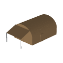

A tan-brown two-room tunnel tent with a tarp on two poles, a white inner bedroom with two blue mattresses, and a hanging milky lantern. It has no logo or product name (ADR 0130).

- **Get one:** find it in the Camping Gear (Outside) group after the Low Chair, or craft it from three wool, one stick, and two string (wool in the top middle, wool on either side of a stick in the middle row, string in the bottom corners). Any wool color works.
- Pitching comes with 9/13 of the tent work. Using the item does nothing yet; a summoned tent just stands there.

## Camp Table (outside the vehicles)

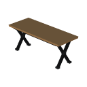

A 30 px long bamboo-colored wooden top on black folding X legs, based on the supplied front, side, top, and grain references. It is long enough for two Low Chairs side by side. Place it from its item on a block top outside vehicle space. Two people can use **Sit** to sit side by side along one long edge; Low Chairs are separate items. The tabletop holds up to two Dutch ovens, one per half, with their lids on; it accepts no other placed items or blocks. The table cannot be folded while an oven stands on it. Hit the table three times in quick succession while nobody is seated to fold it back into its item. In Survival, craft it from three bamboo planks, a stick, and two iron ingots.

## Fire Pit (outside the vehicles)

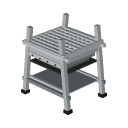

A folding stainless frame with a shallow bowl, lower shelf, and handle. Place its item on a block top outside vehicle space. Tap it with ordinary flint and steel to light it; this uses one durability in Survival. Tap the lit pit again to extinguish it. Hit it three times in quick succession to fold it back into its item. Craft it from three iron ingots and two iron bars. Vibrant Visuals renders its PBR metal surface with mirror-like reflections; its flames and smoke appear in both rendering modes. The fire is visual and does not cook or spread. Use a Dutch Oven item on the pit to stand it on a stainless grill. While the oven is on it, the pit refuses to fold; take the oven back first. Flint and steel still lights and extinguishes the covered pit.

## Dutch Oven (outside the vehicles)

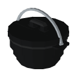

A shallow matte black cast-iron pot with a flat lid, rectangular loop handle, pierced side lugs, and a raised stainless wire bail. The lid is plain, with no lettering, emblem, or brand mark. Find it after the Fire Pit in **Camping Gear (Outside)**. Craft it from six iron ingots and one coal: one ingot in the top center, ingots around coal in the middle row, and three ingots along the bottom. Place its item on a clear block top outside vehicle space; it faces in quarter turns. Hit it three times in quick succession to take it back as one item. On the ground the lid stays on. Use the item on a Fire Pit to stand it on the grill: the lid comes off and a fish, clam, and tomato stew bubbles with steam, even while the pit is unlit. Each pit holds one oven, needs two clear blocks of air, and cannot be folded while the oven stands on it. Taking the oven back removes the grill. Use the item on either half of a Camp Table to place a lidded oven there. Each table holds two ovens, one per half, and refuses a third; an occupied half redirects placement to the free half. The table needs clear air above the oven and cannot be folded until both ovens are taken back. Empty-handed Sit still works. If the pit or table disappears, the oven closes its lid and falls to the ground. Cooking is visual only.

## Gas Lantern (outside the vehicles)

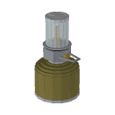

A clear glass cylinder surrounds a brass nozzle beneath a stainless cap. A dark gasket and silver ring sit on a faceted metal burner with a wire handle and brass knob; a smooth dome with a silver collar tops the olive cartridge and its silver bottom rim. There is no logo or lettering.

Find it last in **Camping Gear (Outside)**, after the Dutch Oven. Craft one from glass panes at top center and both middle sides, a torch at middle center, and an iron ingot at bottom center. Items stack to 16. Use it on a block top outside vehicle space with one clear air cell above and no Gas Lantern within 0.75 blocks. It spawns above the pressed block, faces in quarter turns, and falls onto slabs, carpets, and snow layers. Survival placement consumes one item.

Hold the Headlight Switch and press the lantern: right-click on PC or use the "Turn the Gas Lantern On / Off" button on touch. A tap on touch or left-click on PC with the switch also turns it on or off with a click. While on, it lights the area like a torch-bright lamp, and its flame glows with Vibrant Visuals on or off. Its on/off state survives a restart. Pressing with other items or an empty hand does nothing.

Three quick hits with other items or an empty hand take it back as one item; a gap longer than five seconds resets the count. Switch hits never count toward take-back. Taking it back clears its light, and the light follows a falling lantern within a second. A lantern removed by a command right after a restart or `/reload`, before its first light refresh, may leave its light behind (ADR 0173).

## In the game

Inside gear is vehicle-linked and cannot be crafted: each item is only a carrier that works when held and pressed on a parked camper's furniture slot, where the vehicle feature turns it into decor; it does nothing on the ground.

Outside gear consists of plain camp-feature items that anyone can take from Creative or craft in Survival and place on the ground as their own Low Chair, Noga Chair, Tent, Camp Table, Fire Pit, Dutch Oven, or Gas Lantern entity without a camper or any other vehicle present; they are never decor or box contents, and still refuse placement inside a vehicle's space (ADR 0122, 0129, 0152, 0153, 0168).

Creative players find the 17 decor items above in the **Camping Gear (Inside)** group near the end of the Items tab. Each item has a decor block, `yasu_ride:<id>_decor`, that the parked camper lays on a furniture slot. The block has no collision and cannot be broken. Its `yasu_ride:height` state (0 to 15) lifts the gear by that many pixels to the slot's top. On the ceiling hook it lifts the hanging planter so that its top meets the hook. Its `yasu_ride:face` state is the parked camper's facing in quarter turns (0 south, 1 west, 2 north, 3 east). The block turns the gear so that the side shown at the front of its preview faces the camper's front. Its `yasu_ride:spot` state (0 to 4) moves the gear from the middle of its cell to one of the four stove burner spots of ADR 0107, which no slot uses since the stove got one burner in its middle (ADR 0112). A shelf board and the table hold two items, drawn by one block in the furniture's cell, `yasu_ride:shelf_decor_pair` or `yasu_ride:table_decor_pair`, whose states name the item at each end (ADR 0108).

## Getting the gear

The first time you place a camper, you get one Camping Gear Box. Use it (tap or right-click, in the air or on a block) to unpack all 17 items into your inventory, each marked "Camping gear" under its name; what does not fit drops at your feet. Each player gets one box, however many campers they place. In Creative, the Camping Gear (Inside) group near the end of the Items tab holds the box first, then the 17 decor items.
