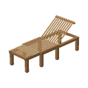
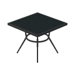
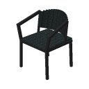

# Resort gear

Beach and resort items that stand outside the vehicles. Back to the [item groups](README.md).

## Beach Parasol


A cantilever parasol with a leaning wooden pole, a dark steel arm, a hanging octagonal canopy, and a stone-slab base (ADR 0236). The canopy is 5 blocks across, wide enough to cover a 3 × 4 block table and chairs. It does not rotate, tilt, or open and close, and nothing collides with it, so players walk through every part.

- **Place it:** use the Beach Parasol item on the top of a block outside vehicle space. The canopy centers over the block you press, and the base sits about 3 blocks away along the direction you face, so it clears a table and chairs under the canopy. Placement is refused, with a hint on the action bar, if the base would overlap blocks or entities, another base is too close, or the ground under the base is not solid. Outside Creative it uses up the item.
- **Rain shelter:** the parasol lays invisible blocks just above the canopy so rain does not fall under it. They are removed when the parasol is taken back. Whether they stop actual rain and snow is not verified on a device yet.
- **Take it back:** hit the base three times in quick succession. The parasol folds into one plain item, and each hit before the third tells you how many more it takes.
- **Paint it:** hit it with a dye to recolor the canopy fabric only. White dye restores the default. A painted parasol returns as a plain item.
- **Get one:** it is the first item in the Resort Gear group, after Camping Gear (Outside) in the Items tab. Survival players also get one on their first join. In Survival, craft it from three white wool, a stick, two iron ingots, and a stone slab (`WWW` / ` SI` / `D I`, with the slab at D).

## Beach Chair



A teak beach lounger, one block wide and three blocks long (16 by 46 px), with an adjustable backrest. It folds into a low table and back (ADR 0239). The player lies on it with a reclined pose (ADR 0238). It seats one player.

- **Place it:** use the Beach Chair item on the top of a block. The pressed cell is the foot end, and the middle and head cells follow along the direction you face, with the backrest at the far end. All three cells need solid full-height support and two clear air layers, outside vehicle and camp space. Outside Creative it uses up the item.
- **Lie down or fold:** tap the chair with anything but a dye to open a menu with Lie down and Fold into a table. Lying down is refused with an action-bar hint while the chair is a table or someone already lies on it. Folding is refused while someone lies on it.
- **Get up:** dismount as usual (sneak on PC, the dismount button on mobile). You are placed beside the middle of the chair on a safe floor, never inside the chair.
- **Table form:** the folded chair is a 16 by 21 px table, 9 px high, with no blocks laid and no block placement on top. Tap it to unfold it directly. It hosts Gas Lanterns and Dutch Ovens: two ovens end to end, one oven and two lanterns, or up to four lanterns. Unfolding is refused while something stands on it.
- **Take it back:** hit it three times in quick succession, in either form. It returns one item. Recovery is refused while someone lies on it or something stands on the table, and the hit count does not advance.
- **Paint it:** hit it with a dye to recolor it.
- **Craft it:** at a crafting table with planks (`P`), sticks (`S`), and an iron ingot (`I`):

```text
PP.
PPP
SIS
```

Owner visual approval and in-game verification are pending. See [Resort gear](../specs/resort-gear.md).

## Dining Table



A square black woven-top table with a steel rim and four tapered legs, 12 by 12 px and 0.75 blocks high, fitted to the owner's photo (ADR 0240). It occupies one floor cell and has no seat.

- **Place it:** use the Dining Table item on the top of a block. The cell above needs solid support and two clear air layers outside vehicle and camp space. Outside Creative it uses up the item.
- **Walk and build on it:** placing lays an invisible block in the cell so the tabletop is solid (ADR 0241). Ordinary blocks can be placed on top with a plain tap, but they begin 16 px above the floor, which leaves a 4 px gap above the tabletop. Blocks that would overlap a hosted item are refused with an action-bar hint (ADR 0242).
- **Host gear:** the top holds one Gas Lantern or one Dutch Oven. Two lanterns do not fit on the 12 px top.
- **Take it back:** hit the table or its top block three times in quick succession. It returns one item and clears the invisible block. Recovery is refused while a hosted item or an ordinary block stands on the tabletop.
- **Paint it:** hit it with a dye to recolor it.
- **Craft it:** at a crafting table with planks (`P`), sticks (`S`), and iron ingots (`I`):

```text
PPP
SIS
II.
```

Place and take-back, both hosting cases, and the top-block checks passed on the dev BDS on 2026-11-10. Owner visual approval and mobile checks are pending. See [Resort gear](../specs/resort-gear.md).

## Dining Chair



A black woven dining chair with steel tube legs, arm tubes, and an arched, reclined back. It occupies one floor cell and seats one player, with the seat 0.45 blocks above the ground (ADR 0240).

- **Place it:** use the Dining Chair item on the top of a block. The cell needs a clear solid floor and two clear air layers, outside vehicle and camp space. Outside Creative it uses up the item.
- **Sit:** use the normal riding interaction. Dismount as usual.
- **Take it back:** hit the empty chair three times in quick succession. It returns one item.
- **Craft it:** see the recipe below.

## The Resort Gear group

Resort Gear follows Camping Gear (Outside) in the creative catalog. Its items are Beach Parasol, Beach Chair, Dining Table, and Dining Chair, in that order.

| Item          | Preview                                                          | Use                                                                                                                |
| ------------- | ---------------------------------------------------------------- | ------------------------------------------------------------------------------------------------------------------ |
| Beach Parasol |  | Place a shade canopy and recover it with three hits.                                                               |
| Beach Chair   |      | Lie down or fold it into a low table that hosts lanterns and ovens.                                                |
| Dining Table  |    | Place a table, host a lantern or oven on it, and recover it with three hits.                                       |
| Dining Chair  |    | Place on a clear solid floor, sit with the normal riding interaction, and recover the empty chair with three hits. |

Craft one Dining Chair at a crafting table with planks (`P`), sticks (`S`), and an iron ingot (`I`):

```text
P..
PPP
SIS
```

Dots are empty slots. The chair occupies one floor cell and needs two clear air layers. Its seat is 0.45 blocks above the ground; it seats one player. See [Resort gear](../specs/resort-gear.md) and the [PC/mobile checks](../manual-test.md#dining-chair-sitting-and-recovery). Owner visual approval and in-game verification are pending.
