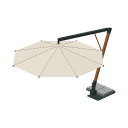

# Resort gear

Beach and resort items that stand outside the vehicles. Back to the [item groups](README.md).

## Beach Parasol

A cantilever parasol with a leaning wooden pole, a dark steel arm, a hanging octagonal canopy, and a stone-slab base (ADR 0236). The canopy is 5 blocks across, wide enough to cover a 3 × 4 block table and chairs. It does not rotate, tilt, or open and close, and nothing collides with it, so players walk through every part.

- **Place it:** use the Beach Parasol item on the top of a block outside vehicle space. The canopy centers over the block you press, and the base sits about 3 blocks away along the direction you face, so it clears a table and chairs under the canopy. Placement is refused, with a hint on the action bar, if the base would overlap blocks or entities, another base is too close, or the ground under the base is not solid. Outside Creative it uses up the item.
- **Rain shelter:** the parasol lays invisible blocks just above the canopy so rain does not fall under it. They are removed when the parasol is taken back. Whether they stop actual rain and snow is not verified on a device yet.
- **Take it back:** hit the base three times in quick succession. The parasol folds into one plain item, and each hit before the third tells you how many more it takes.
- **Paint it:** hit it with a dye to recolor the canopy fabric only. White dye restores the default. A painted parasol returns as a plain item.
- **Get one:** it is the first item in the Resort Gear group, after Camping Gear (Outside) in the Items tab. Survival players also get one on their first join. In Survival, craft it from three white wool, a stick, two iron ingots, and a stone slab (`WWW` / ` SI` / `D I`, with the slab at D).
