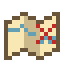

# Vehicle Controls

The tools for driving: the Headlight Switch, the Booster, and Nav. Back to the [item groups](README.md).

| Item                                  | Stack | Recipe                                                  | Where                                            |
| ------------------------------------- | ----- | ------------------------------------------------------- | ------------------------------------------------ |
| [Headlight Switch](#headlight-switch) | 1     | Shapeless: a lever and glowstone dust (always unlocked) | Creative Items tab, next to the Booster          |
| [Booster](#booster)                   | 1     | None                                                    | Creative Items tab, next to the Headlight Switch |
| [Nav](#nav)                           | 1     | None                                                    | Creative Items tab                               |

## Headlight Switch

The light tool. One item turns the headlights of every vehicle on and off, and the same item also lights a parked camper's ceiling lights, the tent lantern, and the Gas Lantern.

See [ADR 0020](../adr/0020-headlights.md), [ADR 0024](../adr/0024-item-use-on-mobile-and-longer-headlights.md), and the [lights spec](../specs/lights.md).

### Vehicles

Works on the SUV, camper, sports boat, scooter, and bulldozer.

- **Switch the headlights:** sit in the driver's seat holding the switch and use it (right-click on PC, tap on touch). Use it again to turn them off. Passengers cannot switch them.
- **Parked camper:** whoever sits at the wheel seat of a parked camper can switch the headlights too ([ADR 0149](../adr/0149-route-the-parked-camper-wheel-seat-to-headlights.md)).
- **What it does:** the lamps glow and the road ahead is lit, following the vehicle. A click plays on each flip. A new vehicle starts with the headlights off; the state survives `/reload` and a server restart.
- **Repeated taps:** one tap that arrives twice flips once. Two taps need half a second between them. The headlights, the booster, and the equipment switches each keep their own cooldown.
- **Third person:** while the chase camera is active, the action bar shows Headlights ON or OFF ([ADR 0224](../adr/0224-third-person-switch-feedback-and-bulldozer-camera.md)).

### Other lights

- **Camper ceiling lights:** press the room switch inside a parked camper with the Headlight Switch in hand ([ADR 0115](../adr/0115-camper-ceiling-lights.md)).
- **Tent lantern:** use the switch on the tent ([ADR 0134](../adr/0134-switch-the-tent-lantern-with-the-headlight-switch.md)).
- **Gas Lantern:** see [Camping gear](camping-gear.md#gas-lantern-outside-the-vehicles).

## Booster

The boost tool. Hold it in the driver's seat and use it to triple the top speed and climb limit of a flying vehicle.

See [ADR 0260](../adr/0260-toggle-flight-boost-with-a-booster.md) and the [flight spec](../specs/flight-and-submarine.md#flight-boost).

### How to use it

- **Toggle:** only the driver can use it. Use it (right-click on PC, tap on touch) to switch the boost on, and again to switch it off. Each vehicle has a 10-tick idle cooldown for it, apart from the headlights and the equipment switches.
- **Works on:** the SUV, camper, scooter, and bulldozer. The sports boat cannot fly, so using the item there only shows "This vehicle cannot use a booster."
- **Stays on:** switching to another held item does not turn it off. It ends when the driver gets out, and the next driver, even a passenger who moves up to the wheel, starts with it off. It is not saved, so a reload or a rebuilt vehicle starts with it off.
- **Third person:** with the chase camera active, the action bar shows Boost ON or OFF.

### What it changes

- **In flight:** the horizontal top speed and the vertical climb limit are three times the vehicle's normal values. Acceleration, braking, drag, takeoff climb, and landing sink stay as they are, so speed builds up as usual.
- **Car and submarine forms:** you can switch it on there, but it only takes effect once the vehicle is flying. Ground, water, and submarine speed never change.
- **Letting go:** when the boost ends (switched off, landed, or the driver left), the extra speed bleeds off over about 20 ticks instead of dropping at once.
- **Ramming:** ram damage and push scale with speed, so a ram near boosted top speed hits about three times as hard.

## Nav

The navigation tool. It stacks to one and has no crafting recipe.

See the [navigation spec](../specs/navigation.md) and [ADR 0261](../adr/0261-navigation-by-explorer-maps-and-a-mob-radar.md).

### Explorer maps

Use Nav while riding a vehicle in the Overworld. On PC, right-click with Nav selected. On touch, tap to use it. Any rider can choose a destination type and receive an explorer map.

With a filled map, open your inventory and move it into the off-hand slot next to your character. On PC, drag it into the slot. On touch, tap the map and then the off-hand slot. Switch to first person to read it while driving. Check visibility on your device. If the map is hard to see, read it in the main hand while stopped. The third-person flight camera hides the held map.

### Find other players

The vanilla Player Locator Bar shows the direction of other visible players above the hotbar. An operator can turn it on with `/gamerule locatorbar true`. The `playerWaypoints` rule controls whose waypoints can appear.
