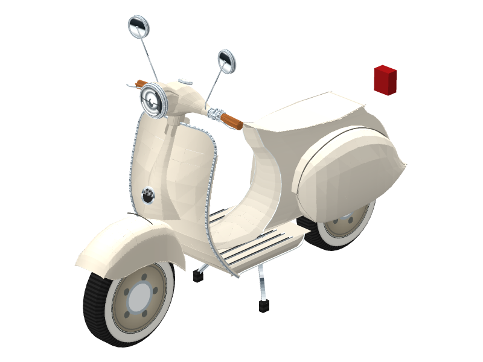
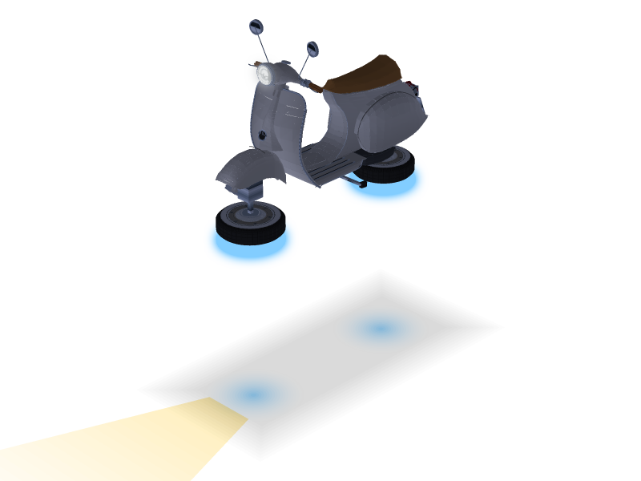
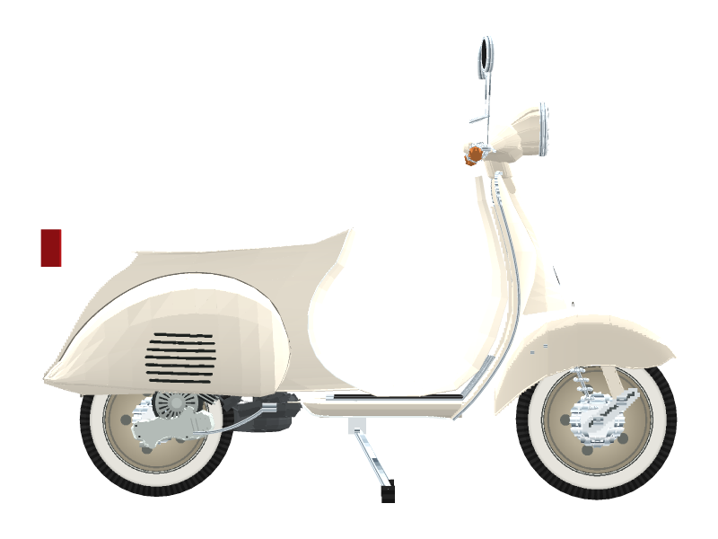
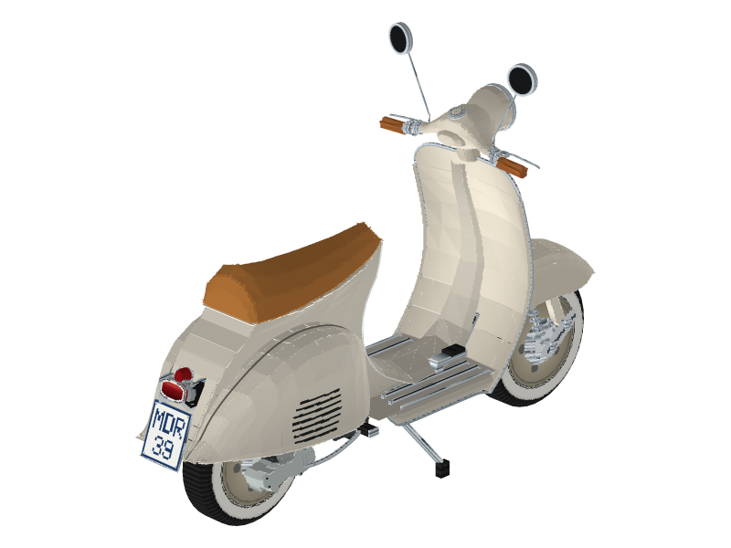

# Scooter

|                                  On the ground                                   |                                   Flying with headlights on                                   |                                       From the side                                       |                                            From the rear                                            |
| :------------------------------------------------------------------------------: | :-------------------------------------------------------------------------------------------: | :---------------------------------------------------------------------------------------: | :-------------------------------------------------------------------------------------------------: |
|  |  |  |  |

A classic two-seat scooter that drives on the ground and across the water surface, and flies with its wheels laid flat like hover discs. Back to the [README](../../README.md).

## Getting one

- Craft the **Scooter** item at a crafting table from 3 iron ingots and 2 coal, shaped like the recipe book shows
- Use the item on the top of a block to place the scooter. It cannot be placed on a liquid
- Hit an empty scooter 3 times, without a dye in hand, to break it back into the item
- Each player keeps at most 10 scooters: placing one more removes that player's oldest
- The **headlight switch** is crafted from a lever and glowstone dust

## Controls

| Action                         | PC (keyboard)                                     | Mobile (touch)                             |
| ------------------------------ | ------------------------------------------------- | ------------------------------------------ |
| Get in                         | Right-click the scooter                           | Press the ride button                      |
| Get out                        | Shift (sneak)                                     | Sneak button                               |
| Accelerate / brake and reverse | W / S                                             | Push the stick forward / back              |
| Steer                          | A / D                                             | Push the stick left / right                |
| Handbrake (slide)              | Space (jump)                                      | Jump button                                |
| Take off / land                | Double-tap Space                                  | Double-tap the jump button                 |
| Climb / descend while flying   | Hold Space / hold S                               | Hold the jump button / pull the stick back |
| Headlights on / off            | Right-click with the switch in hand (driver only) | Tap with the switch in hand (driver only)  |
| Repaint                        | Left-click the scooter with a dye                 | Tap the scooter with a dye                 |

The scooter seats 2. The first player to get in drives from the front seat and the second sits behind. Both riders hold the handlebar pose and lean with the scooter. When the driver gets out, the passenger moves up to the driver's seat.

## How it moves

- **Driving.** It speeds up and turns like the SUV, up to 0.9 blocks per tick (18 blocks per second). The handbrake makes it slide
- **Leaning and steering.** In a turn the scooter leans into it, up to 20 degrees at speed and less at a crawl, and the handlebar with the front wheel and fender turns toward the turn. The riders lean with it in a few steps
- **Stand.** When it is stopped with nobody aboard on dry ground, the centre stand comes down and the scooter stands upright on it. It folds up when someone boards
- **Terrain.** It climbs steps up to two blocks high. Its narrow body does not make it jump onto blocks beside it
- **Water.** It cannot dive. On water it runs on the surface at its ground speed. With nobody driving it floats level and holds still, with no stand. If it falls into deep water or the water rises over it, it is pushed back up to the surface. It can take off from the surface
- **Flying.** On take-off each wheel drops a little below the body and then lies flat under it like a hover disc, tipping toward the driver's left as it turns flat, with a glowing disc and particles underneath. Before landing the wheels rise and turn back to their road positions. The fender, fork and suspension stay in place
- **Ramming.** It damages mobs it hits at speed. The scooter and its riders take no collision damage
- **Headlights.** A long press with the switch in hand switches on the headlight, the rear brake light and the orange lamp above it
- **Paint.** It starts white. Each of the 16 dyes repaints the body in that dye's color, and brown dye turns it back to white. Chrome, tyres, whitewalls, seat, lenses and the plate keep their own colors. Each repaint uses one dye
